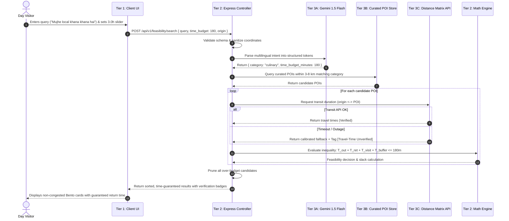

# System Architecture & Technical Topology
**Team Venator (ID: 60358412) • AI Synergy Hackathon 2026**  
**Project:** Time-Aware Digital Discoverability — Beyond the Fort

---

## 1. Architectural Philosophy

The cornerstone of the Venator platform is the **uncompromising demarcation between non-deterministic natural language interpretation and deterministic mathematical enforcement**.

```
    ┌───────────────────────┐
    │    Google Gemini      │ ──► Interprets Intent (Multilingual translation & tokenization)
    │     (Stochastic)      │     Strictly forbidden from fabricating places or travel times.
    └───────────────────────┘
                │
                ▼
    ┌───────────────────────┐
    │    Node.js Engine     │ ──► Proves Facts (Deterministic inequality arithmetic & pruning)
    │    (Deterministic)    │     Evaluates feasibility; injects 25% safety buffer.
    └───────────────────────┘
                │
                ▼
    ┌───────────────────────┐
    │  Curated POI Store    │ ──► Supplies Ground Truth (Human-verified heritage artisans)
    │    (Authoritative)    │     Maintained by community custodians and field audits.
    └───────────────────────┘
```

> **Design Axiom:** *"Gemini interprets intent. Node.js proves facts. The database supplies reality."*

---

## 2. Decoupled 3-Tier Architecture

### Tier 1: Client Presentation Layer
- **Tech Stack:** Server-Rendered EJS (Embedded JavaScript), Vanilla CSS3, Vanilla JS.
- **Form Factor:** Bento Box modular grid, Swiss Minimalist typography (`Space Grotesk` headers, `Inter` body text).
- **Interactive Capabilities:**
  - Dynamic Time Budget Slider ($1.0\text{h}$ to $8.0\text{h}$) with live minute calculations.
  - Multilingual conversational search bar supporting Hindi, Hinglish, and English.
  - Quick-selection category chips for zero-typing interaction.
  - Instant feasibility envelope visualization: Outbound + Return + Dwell + 25% Buffer.

### Tier 2: Application & Feasibility Engine
- **Tech Stack:** Node.js, Express.js.
- **Responsibilities:**
  - **Schema Validation & Boundary Protection (`schemaValidator.js`):** Enforces bounds on user time window ($30\text{m} \le T_{\text{available}} \le 600\text{m}$) and sanitizes geographic coordinates.
  - **Feasibility Math Engine (`feasibilityMath.js`):** Executes deterministic arithmetic:
    $$T_{\text{outbound}} + T_{\text{return}} + T_{\text{visit}} + T_{\text{buffer}} \le T_{\text{available}}$$
  - **Dynamic Buffer Injection:** Generates a mandatory 25% safety cushion:
    $$T_{\text{buffer}} = \lceil 0.25 \times (T_{\text{round\_trip}} + T_{\text{visit}}) \rceil$$
  - **Candidate Pruning:** Strictly drops over-budget candidates, returning only verified time-compliant options.

### Tier 3: Specialized Services & Authoritative Data
- **Google Gemini 1.5 Flash (`geminiService.js`):**
  - High-speed semantic classification.
  - Negative constraints enforced via prompt engineering: zero place fabrication, zero travel estimation.
- **Curated POI Repository (`mongoService.js` & `data/gwalior_curated_pois.json`):**
  - Geospatial indexing targeting the 3–8 km peripheral cultural belt outside Gwalior Fort.
  - Every listing includes human audit timestamps, dwell times, and artisan etiquette rules.
- **Distance Matrix Transit Service (`distanceMatrixService.js`):**
  - City-calibrated driving velocity modeling ($22\text{ km/h}$) with $1.35\times$ road circuity factor.
  - 3000ms circuit-breaker timeout with graceful fallback.

---

## 3. Strict Boundary Matrix

| System Action | Gemini AI | Node.js Backend | Human Steward |
| :--- | :--- | :--- | :--- |
| **Multilingual Query Parsing** | **Authoritative** (Extracts Intent) | Sanitizes & Validates Bounds | N/A |
| **POI Location Discovery** | **Strictly Forbidden** | Reads Curated Database | **Authoritative** (Field Audits) |
| **Travel Duration Calculation**| **Strictly Forbidden** | Computes via Transit/Geometry | Calibrates City Velocity |
| **Feasibility Inequality Math**| **Strictly Forbidden** | **Authoritative** (Strict Math) | Sets 25% Buffer Policy |
| **Candidate Pruning** | **Strictly Forbidden** | **Authoritative** (Eliminates) | Defines Acceptance Limits |
| **Verification Badging** | **Strictly Forbidden** | **Authoritative** (Injects Tag) | Grants Verification Sign-off |

---

## 4. End-to-End Sequence Workflow



---

## 5. Resilience & Circuit-Breaker Failsafes

### Failsafe 1: Ambiguous User Input
- **Scenario:** Visitor enters a completely vague query like *"somewhere good"* without specifying interests.
- **Handling:** System falls back to UI Category Chips (`crafts`, `culinary`, `music`, `textile`), guiding the user to select an explicit interest rather than guessing.

### Failsafe 2: Transit API Network Severance / Outage
- **Scenario:** Google Maps / Distance Matrix API experiences an outage or times out beyond 3000ms.
- **Handling:** The backend executes calibrated Haversine geometric modeling with an urban circuity multiplier ($1.35\times$) but **mandatorily stamps the item with `[Travel-Time Unverified]`**. The platform explicitly warns the visitor that local road conditions must be confirmed before departure.

### Failsafe 3: Gemini Quota Exceeded / Latency Spike
- **Scenario:** Gemini API key reaches rate limits or network connection to Google Cloud fails.
- **Handling:** System activates its deterministic heuristic parser, tokenizing known Hinglish/Hindi keywords (`khana`, `bedai`, `chanderi`, `bunkar`, `tansen`) with zero interruption to the user experience.
